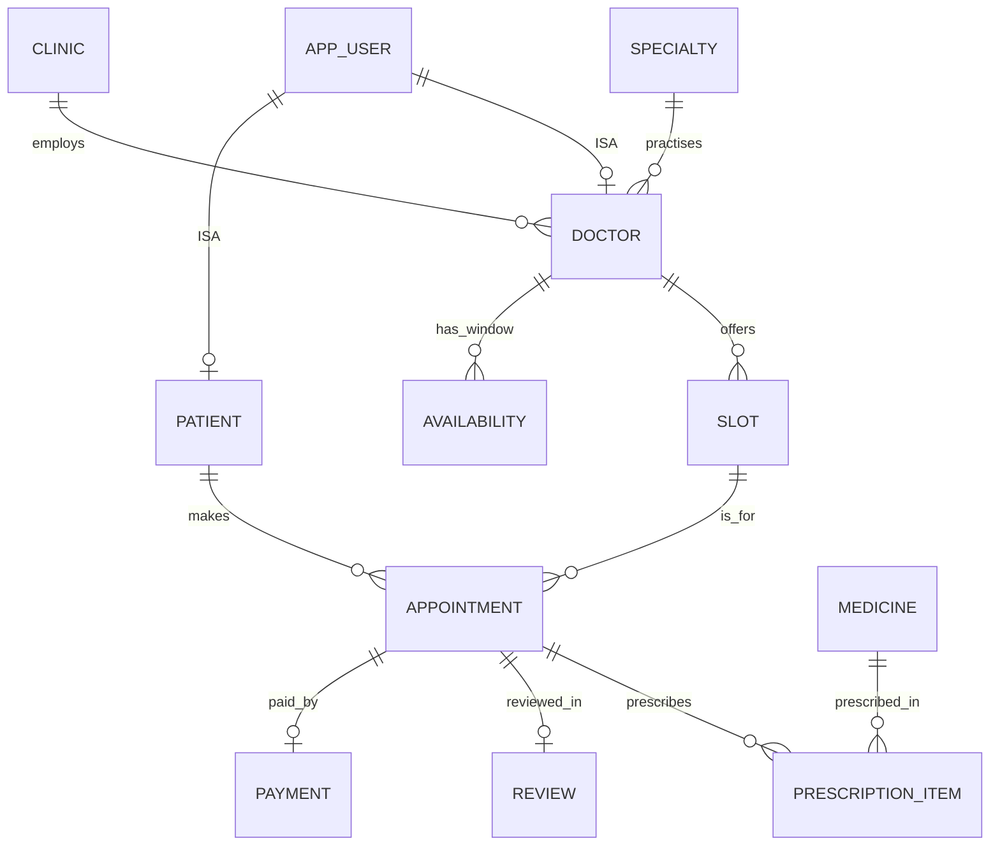

# MediSlot: Doctor Appointment Booking System

**CS F212 Database Systems | BITS Pilani, Hyderabad Campus | Group-6**

MediSlot is a web app where patients search for a doctor by specialty and city, pick a free slot, book it and pay. Doctors set a weekly schedule, see the day's patient list, mark visits done or missed and write prescriptions. An admin manages clinics, specialties and medicines, and watches reports on how busy each doctor is and where the money goes. The rules that matter most (no double booking, no overlapping appointments, refunds that match the payment, reviews only for visits that happened) are enforced by PostgreSQL through constraints, triggers and functions, so they hold no matter which client touches the data.

---

## Team and contributions

| Member                | Roll number   | Contribution |
| --------------------- | ------------- | ------------ |
| Mohammad Mubeen Khan  | 2024A8PS0489H | TODO         |
| Aditya Singh          | 2024A8PS0491H | TODO         |
| Priyadarshini Ghosh   | 2024A8PS0479H | TODO         |
| Potta Avinash         | 2024A8PS0473H | TODO         |
| Suryanath A           | 2024A8PS0471H | TODO         |

---

## Current progress (mid-semester)

Completed: requirements and business rules, the ER diagram (below), relational mapping, normalisation, the full schema with triggers, functions, views and indexes, and a passing test script (39 checks on PostgreSQL 16). In progress: seed data. Planned: Express API, React frontend, admin reports, integration.

| Component                                          | State       |
| -------------------------------------------------- | ----------- |
| Requirements and business rules (R1 to R9)         | Done        |
| ER diagram and relational mapping                  | Done        |
| Normalisation (all 12 relations in BCNF)           | Done        |
| Schema: 12 tables, 6 triggers, 4 functions, 3 views | Done        |
| Test script (39 checks covering R1 to R9)          | Done        |
| Seed data (500+ records)                           | In progress |
| Express API and JWT authentication                 | Planned     |
| React (Vite) frontend                              | Planned     |
| Admin reports and constraint demo                  | Planned     |

---

## Users

| Who     | What they do |
| ------- | ------------ |
| Patient | Finds a doctor by specialty, city, fee or rating, books and pays, cancels for a refund, sees past visits and prescriptions, and reviews completed visits |
| Doctor  | Sets a weekly availability pattern, generates slots from it, sees the day's appointments, marks them completed or no-show, writes prescriptions |
| Admin   | Manages clinics, specialties and medicines, and reads the utilisation, no-show, demand and revenue reports |

### Assumptions

- Each doctor works at one clinic and has one specialty.
- Payments are simulated and in rupees. Times are stored with a time zone and shown in IST.
- Availability is a weekly pattern (for example Monday 9:00 to 12:00 in 30-minute slots). Concrete slots are generated from the pattern for a range of dates.
- A cancelled slot goes back into the pool and can be booked again.
- A booking and its payment happen together. There is no pay-later option.

---

## Rules the database enforces on its own

| ID | Rule | Mechanism |
| -- | ---- | --------- |
| R1 | A slot can never have two live appointments, even when two people click at the same moment | Row lock in `sp_book_appointment`, BEFORE INSERT trigger, partial unique index |
| R2 | A doctor can never have two overlapping slots | EXCLUDE constraint (gist) on doctor and time range |
| R3 | A patient cannot have two overlapping appointments | BEFORE INSERT trigger with an advisory lock per patient |
| R4 | A doctor's weekly windows cannot overlap and must be divided into whole slots (9:00 to 12:00 in 25-minute slots is rejected) | Trigger and CHECK |
| R5 | An appointment goes from BOOKED to COMPLETED, NO_SHOW or CANCELLED, and stops there | BEFORE UPDATE trigger |
| R6 | Reviews and prescriptions are only allowed for completed appointments | BEFORE INSERT triggers |
| R7 | Refund is 100% if cancelled 24 hours or more before the slot, 50% from 2 to 24 hours, nothing under 2 hours. Payment status must agree with the refund amount | `fn_refund_amount` and a CHECK on payment |
| R8 | A doctor row can only belong to a DOCTOR account and a patient row to a PATIENT account | Composite foreign key `(id, role)` |
| R9 | A slot that has already started cannot be booked | `sp_book_appointment` (a CHECK cannot use the current time) |

---

## ER modelling

The model has 9 entities plus the `app_user` supertype, 2 weak entities (`availability`, `slot`), one specialisation (`app_user` into `patient` and `doctor`) and one M:N relationship carrying attributes (`prescribes`, between `appointment` and `medicine`, with `dosage` and `days_supply`).

Things worth highlighting:

- Patient and doctor are specialisations of `app_user`, so name, email and password live in one place. An admin is simply an `app_user` with no subtype, which is why the specialisation is partial.
- `slot` and `availability` are weak entities. A slot only makes sense as one of a particular doctor's slots, so it is identified through the doctor plus its start time.
- `prescribes` carries attributes, so it has its own table.
- A slot can have many appointments over time, but only one at any moment.

### Chen notation

Rectangles are entities, double rectangles are weak entities, diamonds are relationships, double diamonds are identifying relationships. Labels 1, N, M are cardinalities.


### Same model as an ER diagram (renders on GitHub)



### Relationship table

| Relationship | Participants                | Cardinality | Notes                                   |
| ------------ | --------------------------- | ----------- | --------------------------------------- |
| employs      | Clinic, Doctor              | 1:N         | Doctor total                            |
| practises    | Specialty, Doctor           | 1:N         | Doctor total                            |
| ISA          | app\_user, Patient / Doctor | 1:1         | partial specialisation, admin has none  |
| has window   | Doctor, Availability        | 1:N         | Availability weak                       |
| offers       | Doctor, Slot                | 1:N         | Slot weak                               |
| makes        | Patient, Appointment        | 1:N         |                                         |
| is for       | Slot, Appointment           | 1:N         | many over time, one live at a moment    |
| paid by      | Appointment, Payment        | 1:1         | `UNIQUE(appt_id)`                       |
| reviewed in  | Appointment, Review         | 1:1         | `UNIQUE(appt_id)`                       |
| prescribes   | Appointment, Medicine       | M:N         | dosage, days\_supply                    |

---

## Relational schema

Mapping from the diagram was mostly mechanical: entities became tables, subtypes share their key with `app_user`, each 1:N relationship became a foreign key on the N side, 1:1 relationships a UNIQUE foreign key, and `prescribes` became `prescription_item` with a composite key. Weak entities carry their doctor as a foreign key and also get a surrogate id; on `slot`, `UNIQUE (doctor_id, slot_start)` keeps the natural identifier intact.

| Relation          | Primary key              | Foreign keys (ON DELETE) and key constraints |
| ----------------- | ------------------------ | -------------------------------------------- |
| app\_user         | user\_id                 | UNIQUE email (format CHECK); UNIQUE (user\_id, role); role IN (PATIENT, DOCTOR, ADMIN) |
| patient           | patient\_id              | (patient\_id, role) → app\_user(user\_id, role) (CASCADE); role = PATIENT |
| clinic            | clinic\_id               | UNIQUE (name, address); index on city |
| specialty         | specialty\_id            | UNIQUE name |
| doctor            | doctor\_id               | (doctor\_id, role) → app\_user (CASCADE); clinic\_id → clinic (RESTRICT); specialty\_id → specialty (RESTRICT); UNIQUE license\_no |
| availability      | avail\_id                | doctor\_id → doctor (CASCADE); weekday 1 to 7; overlap trigger |
| slot              | slot\_id                 | doctor\_id → doctor (CASCADE); UNIQUE (doctor\_id, slot\_start); EXCLUDE gist on doctor and time range |
| appointment       | appt\_id                 | patient\_id → patient (RESTRICT); slot\_id → slot (RESTRICT); partial UNIQUE (slot\_id) WHERE status <> CANCELLED |
| payment           | payment\_id              | appt\_id → appointment (RESTRICT), UNIQUE |
| medicine          | medicine\_id             | UNIQUE (name, form, strength) |
| prescription\_item | (appt\_id, medicine\_id) | appt\_id → appointment (CASCADE); medicine\_id → medicine (RESTRICT) |
| review            | review\_id               | appt\_id → appointment (CASCADE), UNIQUE |

Key constraints: `email` format CHECK, `phone` 10 to 15 digits, `fee >= 0`, `experience_yrs` 0 to 60, `slot_minutes IN (10, 15, 20, 30, 45, 60)`, `slot_end > slot_start`, `rating` 1 to 5, `days_supply` 1 to 365, `0 <= refund_amount <= amount` with payment status matching the refund, and `cancelled_at` set exactly when status is CANCELLED.

Extra indexes: `slot(slot_start) WHERE status = 'FREE'` for the free-slot search, `appointment(patient_id, status)`, `doctor(specialty_id, clinic_id)`, `clinic(city)` and `availability(doctor_id, weekday)`.

### Normalisation

Functional dependencies were written down for every table. In each one, whatever determines other attributes is a candidate key, so all 12 relations are in BCNF, which also puts them in 3NF. `appointment` has no `doctor_id` (appointment → slot → doctor would be a transitive dependency), and `clinic` stores city but not state, so there is no city → state dependency.

### Design decisions

1. **Partial unique index, not a plain `UNIQUE (slot_id)`.** A plain one breaks on cancellation, because the cancelled row would still hold the slot. The partial index only counts non-cancelled appointments, so history is kept and double booking is still impossible.
2. **Exclusion constraint on slots.** `UNIQUE (doctor_id, slot_start)` only stops identical slots; the exclusion constraint also stops a 10:10 to 10:40 slot from sitting on top of a 10:00 to 10:30 one.
3. **Composite `(id, role)` foreign key** stops a doctor row from referring to a patient account, so no trigger is needed.
4. **`slot.status` is deliberate redundancy.** It makes the free-slot search a single indexed scan, and it is only changed by a trigger in the same transaction as the appointment, so the two cannot drift apart.
5. **`payment.amount` snapshots the doctor's fee** at booking time, because the fee changes over time and an old payment must keep what was actually charged.
6. **Booking, cancelling and slot generation are SQL functions**, so any client (web app, script or test) gets the same guarantees and everything can be demoed from `psql`.
7. **Tested.** `schema.sql` loads on PostgreSQL 16 and 39 checks pass, covering R1 to R9, including two sessions racing for the same slot: the second waits for the first to commit and is then rejected.

---

## Architecture and technology stack

React frontend ↔ Express API ↔ PostgreSQL 16.

| Layer    | Technology                                                       |
| -------- | ---------------------------------------------------------------- |
| Database | PostgreSQL 16 with the `btree_gist` extension                    |
| Backend  | Node.js, Express, `pg` driver (connection pool)                  |
| Frontend | React (Vite), separate patient, doctor and admin pages           |
| Security | JWT authentication, bcrypt password hashing, role checks in API  |

The API stays thin on purpose: it checks the token and role, calls the SQL functions or runs the queries, and turns database errors (unique, check, exclusion, trigger) into readable messages.

### Planned workflows

- **W1: Book an appointment (transaction).** The patient searches by specialty and city, picks a free slot and pays through a simulated gateway. The API calls `sp_book_appointment`, which locks the slot row, inserts the appointment (triggers check the slot is free and the patient has no clash, and mark the slot as booked) and inserts the payment with the fee snapshot. If anything fails, everything rolls back and the slot stays free.
- **W2: Admin reports.** Dashboard with doctor utilisation, no-show rate per clinic, top specialties per city, revenue per clinic per month and the most prescribed medicines, built on views, CTEs and window functions.
- **W3: Constraint demo.** Two browser tabs book the same slot (the second is turned away), a patient books two overlapping slots, a review is posted before the visit is completed, an overlapping availability window is added. In each case the UI shows the database's own error message.

Smaller flows: cancelling with a refund (`sp_cancel_appointment`), a doctor generating slots from the weekly pattern (`sp_generate_slots`), and a doctor completing a visit and writing a prescription.

---

## DBMS features

| Feature      | Objects |
| ------------ | ------- |
| Transactions | Row locks (`FOR UPDATE`) and a per-patient advisory lock in `sp_book_appointment` and `sp_cancel_appointment` |
| Triggers (6) | availability overlap, appointment before insert, slot status sync, status lifecycle, review check, prescription check |
| Functions (4) | `sp_book_appointment`, `sp_cancel_appointment`, `sp_generate_slots`, `fn_refund_amount` |
| Views (3)    | `v_doctor_utilisation`, `v_specialty_demand`, `v_clinic_revenue` |
| Indexes      | Partial index on free slots, gist exclusion index, supporting btree indexes |

### Planned SQL queries

- Doctor utilisation: booked slots against offered slots per doctor, using `v_doctor_utilisation`.
- No-show rate per clinic, with `GROUP BY` and `HAVING`.
- Top specialties per city with `RANK() OVER (PARTITION BY city)`.
- Doctors whose average rating beats the average of their specialty, with a CTE and a subquery.
- Patients with two or more completed visits to the same doctor.
- The next three free slots per doctor in a city, with `ROW_NUMBER()`.
- Most prescribed medicines per specialty (four-table join).
- Monthly net revenue per clinic from `v_clinic_revenue`.

### Seed data (planned)

About 6 clinics, 12 specialties, 30 doctors, 120 patients, 25 medicines, 2,000+ generated slots, 400 appointments with their payments, 250 prescription items and 120 reviews, comfortably past the 500-record mark.

---

## Repository layout

```
MediSlot/
  README.md
  docs/images/               diagram images
  schema.sql                 tables, constraints, triggers, functions, views, indexes
  seed.sql                   seed data (in progress)
  tests/                     constraint test script (R1 to R9)
  server/                    Express API (planned)
  client/                    React (Vite) frontend (planned)
```

## Setup (database)

```
createdb medislot
psql -d medislot -f schema.sql
psql -d medislot -f seed.sql
```

Requires PostgreSQL 16 with the `btree_gist` extension available.

---

GitHub: https://github.com/aditya-1308/MediSlot
