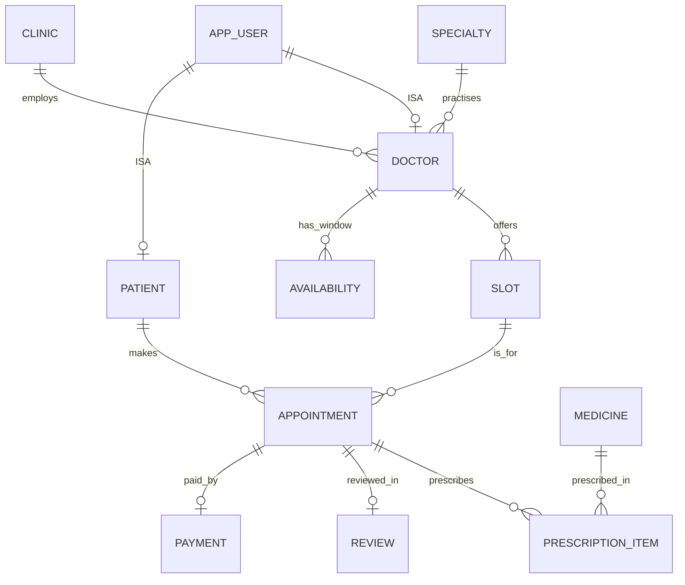

# MediSlot: Doctor Appointment Booking System

**CS F212 Database Systems | BITS Pilani, Hyderabad Campus | Group-6**

MediSlot is a web app where patients search for a doctor by specialty and city, pick a free slot, book it and pay. Doctors set a weekly schedule, see the day's patient list, mark visits done or missed and write prescriptions. An admin manages clinics, specialties and medicines, and watches reports on how busy each doctor is and where the money goes. The rules that matter most (no double booking, no overlapping appointments, refunds that match the payment, reviews only for visits that happened) are enforced by PostgreSQL through constraints, triggers and functions, so they hold no matter which client touches the data.

---

## Team and contributions

| Member                | Roll number   | Contribution |
| --------------------- | ------------- | ------------ |
| Mohammad Mubeen Khan  | 2024A8PS0489H | Booking transaction and app core: `sp_book_appointment`, `sp_cancel_appointment`, `fn_refund_amount`, R1/R3 insert trigger, slot-status sync trigger, row and advisory locking, seeding bypass (`db/03_booking.sql`), booking tests and two-session race demo (`db/tests/test_booking.sql`, `db/tests/race/`), Express core (pool, JWT, bcrypt, `requireRole`, transactional signup, `errors.js`), React shell and booking pages (`report/mubeen.md`) |
| Aditya Singh          | 2024A8PS0491H | Schema and scheduling: Core tables (`db/01_tables.sql`), composite FK (R8), GiST exclusion constraint (R2), availability overlap/divisibility trigger (R4), status lifecycle trigger (R5), `sp_generate_slots` (`db/02_schedule.sql`), schedule unit tests (`db/tests/test_schedule.sql`), doctor API (`server/routes/doctor.js`), and doctor frontend (`report/aditya.md`) |
| Priyadarshini Ghosh   | 2024A8PS0479H | Reporting views and admin management: Analytical views (`v_doctor_utilisation`, `v_specialty_demand`, `v_clinic_revenue` in `db/05_reports.sql`), analytical queries Q1–Q6 (`db/07_queries.sql`), admin backend API (`server/routes/admin.js`), admin dashboard, catalogue management, and report viewer (`client/src/pages/admin/`, `report/priyadarshini.md`) |
| Potta Avinash         | 2024A8PS0473H | Seed data, performance indexing, and search: Transaction-consistent seed dataset (500+ records, 30 doctors, 120 patients in `db/seed.sql`), performance indexes and EXPLAIN plans (`db/06_indexes.sql`), window query Q7 (`queries/q7_next_free_slots.sql`), doctor search API (`server/routes/search.js`), and patient search UI (`client/src/pages/search/`, `report/avinash.md`) |
| Suryanath A           | 2024A8PS0471H | Clinical records, Rule 6 enforcement and QA: R6 completed-visit enforcement triggers (`db/04_clinical.sql`), clinical test suite (`db/tests/test_clinical.sql`), automated runner (`db/tests/runall.sh`), clinical API (`server/routes/clinical.js`), and prescription/review UI (`client/src/pages/clinical/`, `report/suryanath.md`) |

---

## Current progress

All phases completed end-to-end: full relational database schema, integrity constraints and stored procedures, automated test suites, realistic seed dataset, Express backend API, and responsive React frontend.

| Component                                           | State |
| --------------------------------------------------- | ----- |
| Requirements and business rules (R1 to R9)          | Done  |
| ER diagram and relational mapping                   | Done  |
| Normalisation (all 12 relations in BCNF)            | Done  |
| Schema: 12 tables, 8 triggers, 6 functions, 5 views | Done  |
| Performance indexes (5 custom B-tree & partial)     | Done  |
| Test suite (booking, schedule, clinical tests)      | Done  |
| Seed data (500+ records across 30 doctors/120 pts)  | Done  |
| Express API, JWT auth, role guards & error mapping  | Done  |
| React (Vite) frontend (patient, doctor, admin flows)| Done  |
| Admin analytics reports & analytical queries Q1–Q7  | Done  |

---

## Users

| Who     | What they do |
| ------- | ------------ |
| Patient | Finds a doctor by specialty, city, fee or rating, books and pays, cancels for a refund, sees past visits and prescriptions, and reviews completed visits |
| Doctor  | Sets a weekly availability pattern, generates slots from it, sees the day's appointments, marks them completed or no-show, writes prescriptions |
| Admin   | Manages clinics, specialties and medicines, and reads the utilisation, no-show, demand and revenue reports |

### Assumptions

- Each doctor works at one clinic and has one specialty.
- Payments are simulated and in rupees. Times are stored with a time zone and shown in IST.
- Availability is a weekly pattern (for example Monday 9:00 to 12:00 in 30-minute slots). Concrete slots are generated from the pattern for a range of dates.
- A cancelled slot goes back into the pool and can be booked again.
- A booking and its payment happen together. There is no pay-later option.

---

## Rules the database enforces on its own

| ID | Rule | Mechanism |
| -- | ---- | --------- |
| R1 | A slot can never have two live appointments, even when two people click at the same moment | Row lock in `sp_book_appointment`, BEFORE INSERT trigger, partial unique index |
| R2 | A doctor can never have two overlapping slots | EXCLUDE constraint (gist) on doctor and time range |
| R3 | A patient cannot have two overlapping appointments | BEFORE INSERT trigger with an advisory lock per patient |
| R4 | A doctor's weekly windows cannot overlap and must be divided into whole slots (9:00 to 12:00 in 25-minute slots is rejected) | Trigger and CHECK |
| R5 | An appointment goes from BOOKED to COMPLETED, NO_SHOW or CANCELLED, and stops there | BEFORE UPDATE trigger |
| R6 | Reviews and prescriptions are only allowed for completed appointments | BEFORE INSERT triggers |
| R7 | Refund is 100% if cancelled 24 hours or more before the slot, 50% from 2 to 24 hours, nothing under 2 hours. Payment status must agree with the refund amount | `fn_refund_amount` and a CHECK on payment |
| R8 | A doctor row can only belong to a DOCTOR account and a patient row to a PATIENT account | Composite foreign key `(id, role)` |
| R9 | A slot that has already started cannot be booked | `sp_book_appointment` (a CHECK cannot use the current time) |

---

## ER modelling

The model has 9 entities plus the `app_user` supertype, 2 weak entities (`availability`, `slot`), one specialisation (`app_user` into `patient` and `doctor`) and one M:N relationship carrying attributes (`prescribes`, between `appointment` and `medicine`, with `dosage` and `days_supply`).

Things worth highlighting:

- Patient and doctor are specialisations of `app_user`, so name, email and password live in one place. An admin is simply an `app_user` with no subtype, which is why the specialisation is partial.
- `slot` and `availability` are weak entities. A slot only makes sense as one of a particular doctor's slots, so it is identified through the doctor plus its start time.
- `prescribes` carries attributes, so it has its own table.
- A slot can have many appointments over time, but only one at any moment.

### Chen notation

Rectangles are entities, double rectangles are weak entities, diamonds are relationships, double diamonds are identifying relationships. Labels 1, N, M are cardinalities.


### Same model as an ER diagram



### Relationship table

| Relationship | Participants                | Cardinality | Notes                                   |
| ------------ | --------------------------- | ----------- | --------------------------------------- |
| employs      | Clinic, Doctor              | 1:N         | Doctor total                            |
| practises    | Specialty, Doctor           | 1:N         | Doctor total                            |
| ISA          | app\_user, Patient / Doctor | 1:1         | partial specialisation, admin has none  |
| has window   | Doctor, Availability        | 1:N         | Availability weak                       |
| offers       | Doctor, Slot                | 1:N         | Slot weak                               |
| makes        | Patient, Appointment        | 1:N         |                                         |
| is for       | Slot, Appointment           | 1:N         | many over time, one live at a moment    |
| paid by      | Appointment, Payment        | 1:1         | `UNIQUE(appt_id)`                       |
| reviewed in  | Appointment, Review         | 1:1         | `UNIQUE(appt_id)`                       |
| prescribes   | Appointment, Medicine       | M:N         | dosage, days\_supply                    |

---

## Relational schema

Mapping from the diagram was mostly mechanical: entities became tables, subtypes share their key with `app_user`, each 1:N relationship became a foreign key on the N side, 1:1 relationships a UNIQUE foreign key, and `prescribes` became `prescription_item` with a composite key. Weak entities carry their doctor as a foreign key and also get a surrogate id; on `slot`, `UNIQUE (doctor_id, slot_start)` keeps the natural identifier intact.

| Relation          | Primary key              | Foreign keys (ON DELETE) and key constraints |
| ----------------- | ------------------------ | -------------------------------------------- |
| app\_user         | user\_id                 | UNIQUE email (format CHECK); UNIQUE (user\_id, role); role IN (PATIENT, DOCTOR, ADMIN) |
| patient           | patient\_id              | (patient\_id, role) → app\_user(user\_id, role) (CASCADE); role = PATIENT |
| clinic            | clinic\_id               | UNIQUE (name, address); index on city |
| specialty         | specialty\_id            | UNIQUE name |
| doctor            | doctor\_id               | (doctor\_id, role) → app\_user (CASCADE); clinic\_id → clinic (RESTRICT); specialty\_id → specialty (RESTRICT); UNIQUE license\_no |
| availability      | avail\_id                | doctor\_id → doctor (CASCADE); weekday 1 to 7; overlap trigger |
| slot              | slot\_id                 | doctor\_id → doctor (CASCADE); UNIQUE (doctor\_id, slot\_start); EXCLUDE gist on doctor and time range |
| appointment       | appt\_id                 | patient\_id → patient (RESTRICT); slot\_id → slot (RESTRICT); partial UNIQUE (slot\_id) WHERE status <> CANCELLED |
| payment           | payment\_id              | appt\_id → appointment (RESTRICT), UNIQUE |
| medicine          | medicine\_id             | UNIQUE (name, form, strength) |
| prescription\_item | (appt\_id, medicine\_id) | appt\_id → appointment (CASCADE); medicine\_id → medicine (RESTRICT) |
| review            | review\_id               | appt\_id → appointment (CASCADE), UNIQUE |

Key constraints: `email` format CHECK, `phone` 10 to 15 digits, `fee >= 0`, `experience_yrs` 0 to 60, `slot_minutes IN (10, 15, 20, 30, 45, 60)`, `slot_end > slot_start`, `rating` 1 to 5, `days_supply` 1 to 365, `0 <= refund_amount <= amount` with payment status matching the refund, and `cancelled_at` set exactly when status is CANCELLED.

Extra indexes: `slot(slot_start) WHERE status = 'FREE'` for the free-slot search, `appointment(patient_id, status)`, `doctor(specialty_id, clinic_id)`, `clinic(city)` and `availability(doctor_id, weekday)`.

### Normalisation

Functional dependencies were written down for every table. In each one, whatever determines other attributes is a candidate key, so all 12 relations are in BCNF, which also puts them in 3NF. `appointment` has no `doctor_id` (appointment → slot → doctor would be a transitive dependency), and `clinic` stores city but not state, so there is no city → state dependency.

### Design decisions

1. **Partial unique index, not a plain `UNIQUE (slot_id)`.** A plain one breaks on cancellation, because the cancelled row would still hold the slot. The partial index only counts non-cancelled appointments, so history is kept and double booking is still impossible.
2. **Exclusion constraint on slots.** `UNIQUE (doctor_id, slot_start)` only stops identical slots; the exclusion constraint also stops a 10:10 to 10:40 slot from sitting on top of a 10:00 to 10:30 one.
3. **Composite `(id, role)` foreign key** stops a doctor row from referring to a patient account, so no trigger is needed.
4. **`slot.status` is deliberate redundancy.** It makes the free-slot search a single indexed scan, and it is only changed by a trigger in the same transaction as the appointment, so the two cannot drift apart.
5. **`payment.amount` snapshots the doctor's fee** at booking time, because the fee changes over time and an old payment must keep what was actually charged.
6. **Booking, cancelling and slot generation are SQL functions**, so any client (web app, script or test) gets the same guarantees and everything can be demoed from `psql`.
7. **Tested.** `schema.sql` loads on PostgreSQL 16 and 39 checks pass, covering R1 to R9, including two sessions racing for the same slot: the second waits for the first to commit and is then rejected.

---

## Architecture and technology stack

React frontend ↔ Express API ↔ PostgreSQL 16.

| Layer    | Technology                                                       |
| -------- | ---------------------------------------------------------------- |
| Database | PostgreSQL 16 with the `btree_gist` extension                    |
| Backend  | Node.js, Express, `pg` driver (connection pool)                  |
| Frontend | React (Vite), separate patient, doctor and admin pages           |
| Security | JWT authentication, bcrypt password hashing, role checks in API  |

The API stays thin on purpose: it checks the token and role, calls the SQL functions or runs the queries, and turns database errors (unique, check, exclusion, trigger) into readable messages.

### Workflows implemented

- **W1: Book an appointment (atomic transaction).** The patient searches doctors by specialty, city, or date, chooses an available slot, and books via `/api/booking/book`. The backend invokes `sp_book_appointment`, which:
  1. Acquires a patient-level transactional advisory lock (`pg_advisory_xact_lock(4801, patient_id)`) to prevent concurrent overlapping bookings by the same patient.
  2. Locks the target slot row (`SELECT ... FOR UPDATE`), asserting current status is `FREE` and slot start time is strictly in the future (R9).
  3. Inserts the appointment record and verifies against R1 (no double booking) and R3 (no patient time clash) via database triggers.
  4. Inserts the payment record, snapshotting the doctor's active consultation fee and payment method (`CASH`, `CARD`, `UPI`).
  5. The `AFTER INSERT` trigger automatically synchronizes `slot.status` to `BOOKED`. If any step fails, the entire transaction rolls back cleanly.

- **W2: Admin portal and reporting views.** The admin dashboard (`/admin`) provides platform-wide oversight:
  1. System metrics cards: registered clinics, specialties, medicines, doctor/patient counts, active bookings, and net revenue.
  2. Master catalogue management: interactive CRUD for medical specialties and medicines (form, dosage, strength).
  3. Clinics overview: view doctor counts per clinic registered by doctors.
  4. Reporting suite: real-time query rendering for `v_doctor_utilisation`, `v_specialty_demand`, `v_clinic_revenue`, and analytical queries Q1–Q7.

- **W3: Clinical records and Rule 6 constraint demonstration.**
  1. Doctors view their daily schedule (`/doctor`), mark appointments as `COMPLETED` or `NO_SHOW` (R5 lifecycle enforcement), and issue prescriptions (`/visits/:apptId/prescription`).
  2. Patients view consultation history (`/appointments`), read prescriptions, and submit reviews (1–5 stars with comments).
  3. Rule 6 is strictly enforced at the database level by `BEFORE INSERT OR UPDATE` triggers on `prescription_item` and `review`. Attempting to prescribe or review a `BOOKED` or `CANCELLED` visit terminates immediately with `R6: Prescriptions and reviews are only allowed for completed appointments`.

- **Additional core workflows:**
  - **Appointment cancellation & tiered refunds (`sp_cancel_appointment`):** Locks the appointment, evaluates `fn_refund_amount` (100% ≥ 24 h, 50% for 2–24 h, 0% < 2 h), updates payment status to `REFUNDED` / `PARTIALLY_REFUNDED` / `COMPLETED`, releases the slot back to `FREE`, and records `cancelled_at` timestamp.
  - **Automated slot generation (`sp_generate_slots` / `sp_generate_all_slots`):** Expands doctors' weekly availability windows into discrete time-bound slots across target date ranges, guarded against duplicates and overlaps by the GiST exclusion constraint (R2).
  - **Doctor registration with clinic creation:** Doctors can sign up (`/signup/doctor`) by selecting an existing clinic or creating a new clinic on the fly in a single atomic transaction.

---

## DBMS features

| Feature | Objects & Implementation |
| ------- | ------------------------ |
| **Transactions & Concurrency** | Row-level locks (`SELECT ... FOR UPDATE`), transaction-level advisory locks (`pg_advisory_xact_lock(4801, patient_id)`), atomic multi-table stored procedures (`sp_book_appointment`, `sp_cancel_appointment`), READ COMMITTED isolation. |
| **Triggers (7)** | `trg_check_availability_overlap` (`availability`), `trg_check_appointment_clash` (`appointment`), `trg_sync_slot_status` (`appointment`), `trg_appointment_status_lifecycle` (`appointment`), `trg_protect_booked_slots` (`slot`), `trg_enforce_r6_prescription` (`prescription_item`), `trg_enforce_r6_review` (`review`). |
| **Functions & Procedures (7)** | `sp_book_appointment`, `sp_cancel_appointment`, `sp_generate_slots`, `sp_generate_all_slots`, `fn_refund_amount`, `fn_check_completed_appointment`, `fn_check_availability_overlap`. |
| **Views (7)** | `v_slot_details`, `v_patient_appointments`, `v_doctor_appointments`, `v_doctor_profile`, `v_doctor_utilisation`, `v_specialty_demand`, `v_clinic_revenue`. |
| **Indexes (7)** | GiST exclusion constraint (`slot_no_overlap`), partial unique index (`idx_appointment_slot_active`), partial B-tree (`idx_slot_doctor_start_status`), composite indexes (`idx_doctor_specialty_clinic`, `idx_appointment_patient`, `idx_payment_appt`, `idx_clinic_city`). |

---

## Analytical SQL queries (Q1–Q7)

All seven analytical queries are implemented in `db/07_queries.sql` and `queries/q7_next_free_slots.sql`, and accessible via the admin reports interface:

- **Q1: Peak Booking Hours:** Groups slot start timestamps by `EXTRACT(HOUR FROM s.slot_start)` to evaluate diurnal booking distributions.
- **Q2: Doctor Performance vs Specialty Benchmark:** Uses Common Table Expressions (CTEs) and subqueries to calculate average ratings per specialty and identify doctors who outperform their specialty average.
- **Q3: Top Doctors by Completed Visits:** Utilizes `DENSE_RANK() OVER (ORDER BY completed_count DESC)` to rank doctors across the platform.
- **Q4: Patient Retention Analysis:** Aggregates completed visits grouped by `(patient_id, doctor_id)` with `HAVING COUNT(a.appt_id) >= 2` to highlight repeat consultations.
- **Q5: Revenue Distribution by Payment Method:** Evaluates gross revenue, total refund liabilities, and net revenue split across `CASH`, `CARD`, and `UPI`.
- **Q6: Doctor Cancellation Rate:** Identifies practitioners with elevated cancellation frequencies using conditional aggregation and `HAVING`.
- **Q7: Next Three Free Slots per Doctor:** Implemented in `queries/q7_next_free_slots.sql` using window function `ROW_NUMBER() OVER (PARTITION BY s.doctor_id ORDER BY s.slot_start)`. Validated with before/after `EXPLAIN ANALYZE` benchmarks in `db/explain/` showing acceleration from index-only scans.

---

## Seed dataset

The database includes a realistic dataset defined in `db/seed.sql` comprising 500+ records:
- 6 Clinics across Hyderabad, Bengaluru, and Mumbai.
- 12 Medical Specialties (Cardiology, Dermatology, Orthopedics, Pediatrics, etc.).
- 30 Doctors with verified licenses, experience records, and consultation fees.
- 120 Patients with demographics and dates of birth.
- 25 Medicines with standard dosage forms (`TABLET`, `CAPSULE`, `SYRUP`, `INJECTION`, `OINTMENT`, `DROPS`, `OTHER`).
- 2,000+ Concrete Slots generated from weekly doctor availability patterns.
- 400 Appointments with associated payments (seeded through `sp_book_appointment` and `sp_cancel_appointment` under `SET medislot.seeding = 'on'` to maintain relational consistency and accurate refund amounts).
- 250 Prescription Items and 120 Patient Reviews.
- Platform Admin account: `admin@medislot.demo` / `admin123`.

---

## Test suite and automated runner

The project includes automated SQL test suites covering all business rules:
- `db/tests/test_schedule.sql`: 40 transactional assertions validating availability intervals, slot generation, appointment lifecycle transitions, and doctor views.
- `db/tests/test_booking.sql`: 27 assertions verifying R1 (no double booking), R3 (no patient overlap), R7 (refund edge cases at 24 h and 2 h), R9 (no booking past slots), advisory locking, and view outputs.
- `db/tests/test_clinical.sql`: Verifies positive and negative scenarios for Rule 6 (prescriptions and reviews permitted on completed visits; rejected on booked visits).
- `db/tests/race/`: Two-session concurrent race script demonstrating physical row-lock serialisation on double-booking attempts.
- `db/tests/runall.sh`: Shell script running schema initialization, seed data loading, and all unit tests in a clean sequence with `ON_ERROR_STOP=1`.

---

## Repository layout

```
MediSlot/
  README.md
  docs/images/               diagram images
  db/
    01_tables.sql            tables, CHECKs, FKs, composite FK (R8), GiST exclusion (R2), partial index
    02_schedule.sql          availability trigger (R4), status lifecycle (R5), sp_generate_slots
    03_booking.sql           booking transactions, cancellation, refund calculation
    04_clinical.sql          prescriptions & reviews (R6)
    05_reports.sql           reporting views (doctor utilisation, specialty demand, clinic revenue)
    06_indexes.sql           performance indexes
    07_queries.sql           analytical queries (Q1–Q6)
    seed.sql                 seed data (500+ records)
    tests/
      test_schedule.sql      unit test suite for R2, R4, R5, R8 & slot generation (40 assertions)
      test_booking.sql       booking test suite (R1, R3, R7, R9, 27 assertions)
      test_clinical.sql      clinical test suite (R6)
      runall.sh              automated runner across 01-07 on fresh DB
  server/                    Express backend (auth, booking, doctor, clinical, admin, search)
  client/                    React Vite frontend (patient, doctor, admin portals)
  report/                    individual contribution reports (mubeen, aditya, avinash, priyadarshini, suryanath)
```

## Setup (database)

```bash
createdb medislot
psql -d medislot -f db/01_tables.sql
psql -d medislot -f db/02_schedule.sql
# Run test suite
psql -d medislot -f db/tests/test_schedule.sql
```

Requires PostgreSQL 16 with the `btree_gist` extension available.

Booking layer and its tests:

```bash
psql -d medislot -f db/03_booking.sql
psql -d medislot -f db/tests/test_booking.sql
```

Two-session race (R1), on a seeded database: run `db/tests/race/session_a.sql` in one terminal and, while it waits, `db/tests/race/session_b.sql` in another.

## Setup (application)

```bash
cd server
cp .env.example .env        # set DATABASE_URL and JWT_SECRET
npm install
npm start                   # API on http://localhost:4000
```

```bash
cd client
npm install
npm run dev                 # UI on http://localhost:5173, /api proxied to :4000
```

Adding your area: put an Express router in `server/routes/<area>.js` (mounted at `/api` automatically) and your pages in `client/src/pages/<area>/` with a `routes.jsx` that default-exports `[{ path, element, roles, nav }]` (picked up automatically). Use `requireRole(...)` from `server/auth/requireRole.js` and `api` from `client/src/api.js`. Seeded users need bcrypt password hashes (for example `crypt('password', gen_salt('bf'))` from `pgcrypto`) to be able to log in.

---

## Individual contribution reports

Full technical documentation and design write-ups by each team member are located in the `report/` directory:
- [Mohammad Mubeen Khan (`report/mubeen.md`)](file:///d:/MediSlot/report/mubeen.md): Atomic booking transaction (`sp_book_appointment`), cancellation & tiered refund calculation (`sp_cancel_appointment`, `fn_refund_amount`), R1/R3 database triggers, row and advisory locking, seeding bypass, Express core, and booking UI.
- [Aditya Singh (`report/aditya.md`)](file:///d:/MediSlot/report/aditya.md): Relational schema design, BCNF normalisation, composite subtype foreign keys (R8), GiST exclusion constraints (R2), weekly availability and slot generation routines (`sp_generate_slots`), doctor routes, and scheduling interface.
- [Potta Avinash (`report/avinash.md`)](file:///d:/MediSlot/report/avinash.md): Transaction-consistent seed dataset (500+ records across 30 doctors and 120 patients), 5 custom performance B-tree and partial indexes (`db/06_indexes.sql`), EXPLAIN execution plan benchmarking, window query Q7 (`queries/q7_next_free_slots.sql`), doctor search API, and search UI.
- [Priyadarshini Ghosh (`report/priyadarshini.md`)](file:///d:/MediSlot/report/priyadarshini.md): Analytical database views (`v_doctor_utilisation`, `v_specialty_demand`, `v_clinic_revenue`), advanced SQL analytics suite (Q1–Q6 in `db/07_queries.sql`), admin API endpoints (`server/routes/admin.js`), and admin portal interface (`client/src/pages/admin/`).
- [Suryanath A (`report/suryanath.md`)](file:///d:/MediSlot/report/suryanath.md): Database enforcement of Rule 6 via `BEFORE INSERT OR UPDATE` triggers on `prescription_item` and `review`, transactional clinical test suite (`db/tests/test_clinical.sql`), clinical API routes, and prescription/review user interface.

---

GitHub: https://github.com/aditya-1308/MediSlot
